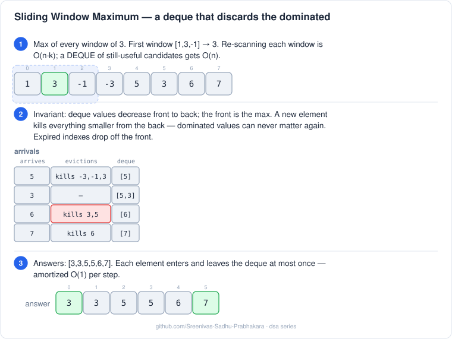

# Sliding Window Maximum

> Striver SDE Sheet 086 · Day 14 Stack & Queue II — a deque of undominated indexes, decreasing by value; the front is every window's answer. Go, stdlib only, tested.

## Problem

Report the maximum of each contiguous window of length k as it slides across the array — in O(n) total, not O(n·k).

## Approach

Maintain a deque of indexes whose values strictly decrease front to back. The discipline has two evictions: drop the front when it slides out of the window (too old), and drop from the back every value ≤ the incoming one (dominated — smaller *and* older, it can never be a future maximum). What remains are exactly the elements that could still matter, newest-but-smaller behind older-but-larger, so the front is always the current maximum. Every index enters and leaves the deque at most once: amortized O(1) per step. This "monotonic deque" is the sliding-window analogue of Day 14's monotonic stacks.

**Complexity:** O(n) time, O(k) space.

## Visual walkthrough

Read the picture top to bottom — each numbered frame is one moment of the algorithm
running on this repo's test example.

## Run

    go test ./...   # verify
    go run .        # demo

---

One of 191 repos solving Striver's SDE Sheet in Go — stdlib only, one problem per repo, every solution tested. Browse the set: [`dsa-*` repos](https://github.com/Sreenivas-Sadhu-Prabhakara?tab=repositories&q=dsa-&type=source).
